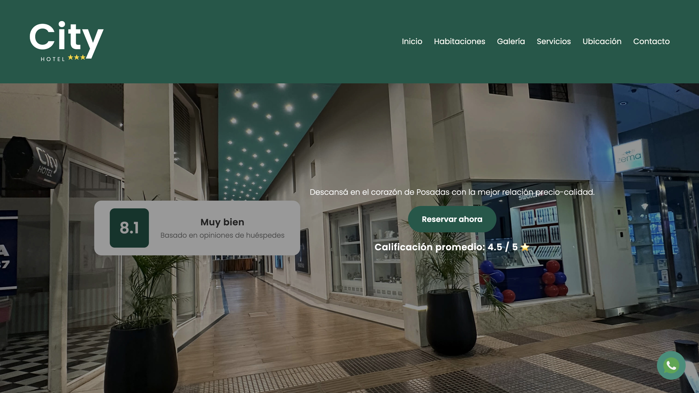

# Hotel City Posadas

A website developed for Hotel City, a hotel located in Posadas, Misiones, Argentina.

## 🏨 About the Project

Hotel City Posadas is a website developed to showcase a hotel located in Posadas, Misiones, Argentina.

The website provides visitors with information about the hotel, its rooms, services, location and contact options. It also allows potential guests to make reservation inquiries.

## ✨ Features

- Hotel presentation with an image slider
- Four room categories with prices and photo galleries
- General photo gallery
- Hotel services information
- Integrated Google Maps location
- Reservation inquiry form
- Direct WhatsApp contact and reservation links
- Interactive navigation menu
- Image lightbox
- Responsive design

## 📸 Preview

## 🛠️ Technologies

- HTML
- CSS
- JavaScript

## 🌐 Live Demo

[Visit Hotel City Website](https://matt091088.github.io/hotel-city-posadas/)

## 👨‍💻 Development

Independently developed by me, with AI-assisted guidance throughout the development process.
